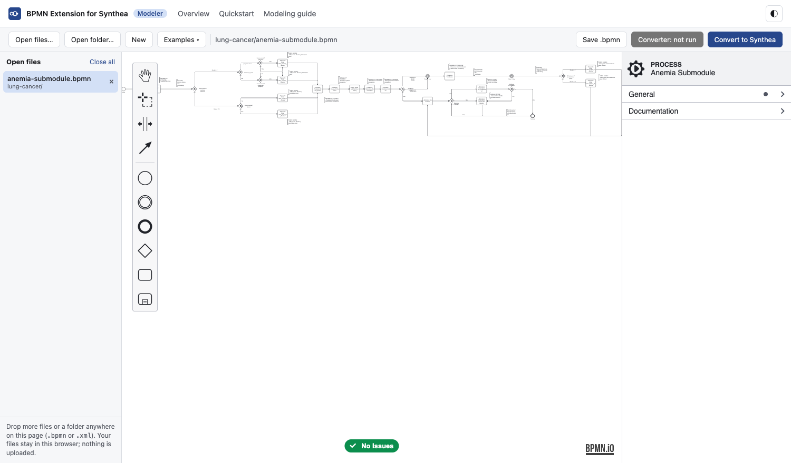
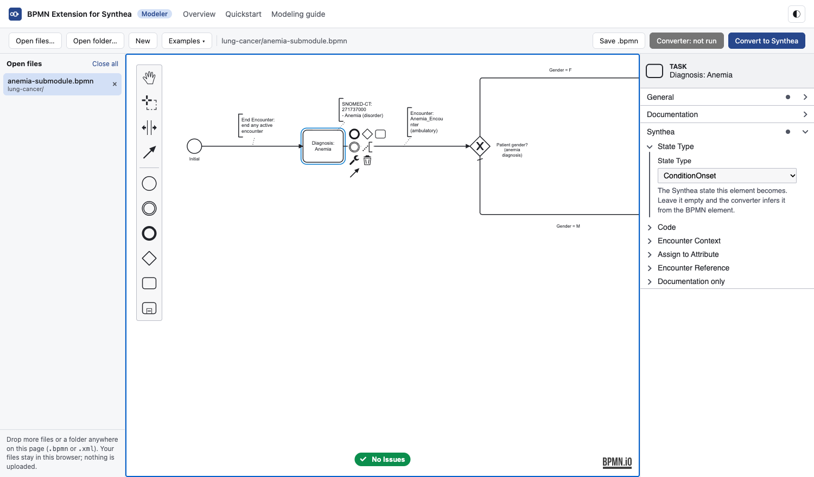
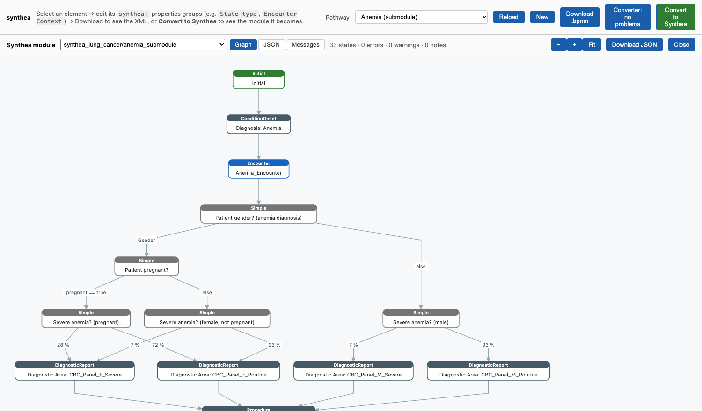

# BPMN Extension Synthea Module

**Model a patient pathway in BPMN and turn it into a runnable [Synthea](https://github.com/synthetichealth/synthea) module.**

> **Status: under development — research prototype.**
> The moddle schema, the properties panel and the converter may change without notice.
> Use it with **synthetic data only**; it is not meant to process real patient data.

**Live preview:** <https://forschungsgruppe-digital-health.github.io/bpmn-extension-synthea-module/>
(the modeler with the extension and the converter result for the lung cancer pathway).

BPMN has no probabilities, no Synthea state types and no encounter groups. This repository adds
them as a [bpmn.io](https://bpmn.io) extension in the namespace `synthea:`, without changing the BPMN
standard, and ships a converter that writes the result as Synthea Generic Module Framework (GMF)
JSON. A pathway stays readable for people; the extension carries what the machine needs.

## Funding

This work is part of **MiHUB – Medical Informatics Hub**, a Digital Progress Hub
(Digitaler FortschrittsHub Gesundheit) of the German Medical Informatics
Initiative (MII).

MiHUB is funded by the German Federal Ministry of Research, Technology and Space
(Bundesministerium für Forschung, Technologie und Raumfahrt, BMFTR) under grant
number **01ZZ2506A** (01/2026 – 12/2029). The responsibility for the content of
this publication lies with the authors.

- Project: <https://mihubx.de/mihub/>
- Funding record: [Förderkatalog des Bundes, FKZ 01ZZ2506A](https://foerderportal.bund.de/foekat/jsp/SucheAction.do?actionMode=view&fkz=01ZZ2506A)
- Funder: BMFTR ([ROR 04pz7b180](https://ror.org/04pz7b180))

<details>
<summary>Förderhinweis (deutsch)</summary>

Das diesem Repository zugrunde liegende Vorhaben wurde mit Mitteln des
Bundesministeriums für Forschung, Technologie und Raumfahrt (BMFTR) unter dem
Förderkennzeichen 01ZZ2506A gefördert. Die Verantwortung für den Inhalt dieser
Veröffentlichung liegt bei den Autor:innen.

</details>

## Table of contents

- [Funding](#funding)
- [What is in the repository](#what-is-in-the-repository)
- [Quick start](#quick-start)
- [What the XML looks like](#what-the-xml-looks-like)
- [From BPMN to Synthea](#from-bpmn-to-synthea)
- [What is supported and what is not](#what-is-supported-and-what-is-not)
- [Where do I change what?](#where-do-i-change-what)
- [Documentation](#documentation)
- [Contributing](#contributing)
- [Citation](#citation)
- [License](#license)

## What is in the repository

| Part | Where | What it does |
|---|---|---|
| **Moddle descriptor** | `extension/model/synthea.json` | The 28 `synthea:` types (and 13 enums): state type, clinical code, probability, condition, delay, guard, encounter, attribute links, … The XSD in `extension/model/synthea.xsd` is generated from it. |
| **Properties panel** | `extension/src/` | One group "Synthea" in the bpmn-js properties panel, one collapsible section per type, showing only what fits the chosen State Type and what the converter accepts. |
| **Lint plugin** | `extension/lint/bpmnlint-plugin-synthea/` | 33 [bpmnlint](https://github.com/bpmn-io/bpmnlint) rules that catch mistakes while modeling: probability sums over 1, inconsistent encounter groups, missing fields. See [docs/lint-rules.md](docs/lint-rules.md). |
| **Converter** | `extension/src/converter/` | Turns the BPMN files into Synthea GMF JSON and checks the result. |
| **Example pathway** | `examples/lung-cancer/` | The Synthea lung cancer pathway: a main module and four submodules, called through call activities. |
| **Tests** | `extension/test/` | `npm test`: converter, lint rules, properties panel, and the golden files of the example pathway. |
| **Checks and build scripts** | `tools/` | What `npm run validate` runs besides the tests (round trip, XSD, conventions), the generators of the XSD and the module schema, the site build. |
| **Drafts** | `examples/drafts/` | The first draft diagrams (v0.1), kept to show where the models started. |
| **Demo** | `demo/` | A bpmn-js modeler with the extension, for trying it by hand. Not published. |
| **Documentation** | `docs/`, `docs-site/` | Modeling guide, mapping rules, converter concept, extension matrix, architecture decisions; `docs-site/` builds the GitHub Pages site from them. |

## Quick start

Requires Node.js 22 or newer.

```bash
git clone https://github.com/forschungsgruppe-digital-health/bpmn-extension-synthea-module.git
cd bpmn-extension-synthea-module
npm install

npm run demo        # the modeler with the extension, in the browser
npm run validate    # all checks (lint, round trip, XSD, tests, converter)
```

The modeler opens your own `.bpmn` or `.xml` files or a whole folder (button, or drop them on the page).
The **Examples** menu opens the five real pathway files of `examples/lung-cancer/`. Click an
element and open the group "Synthea" in the properties panel. Your files and changes stay in the
browser (nothing is uploaded); **Save .bpmn** downloads the open diagram.

**Convert to Synthea** runs the converter in the browser on the diagram that is open, with the edits
you made, and shows the Synthea module as a graph, as JSON and as messages (each kind of message
comes with an explanation and what to do), with a download of the JSON. On the published site
(GitHub Pages, built from the `dev` branch) the site root is the overview and the guides (from `docs/`, built by `docs-site/`), the modeler lives under `modeler/`, and the link **Converter result** opens the modules and
the report that the converter made from `examples/lung-cancer/` at that merge, with the commit they come from.

### First steps in the modeler

1. Start the modeler (`npm run demo`, `docker compose up`, or open the live preview) and choose **Examples → Anemia (submodule)** in the toolbar.

   

2. Click the task **Diagnosis: Anemia**. In the properties panel on the right open the group **Synthea**. **State Type** says `ConditionOnset`, the section **Code** holds the code system, the code and the display text. Fields that are easy to get wrong have a short explanation under them.

   

3. Click a flow that leaves a gateway: the group **Probability** holds its probability. The numbers of all flows of one gateway must add up to 1.0. Change one and the green **No Issues** at the bottom tells you what is wrong, while you work.

4. Click **Convert to Synthea**. The result is the Synthea module as a graph, as JSON and as a list of messages, each with an explanation and what to do. The conversion runs only when you click; after the next change the toolbar says it has not run since.

   

### Your own small pathway

1. Click **New**. You get a start event joined to an end event; drag a task from the palette onto the arrow between them. The start event is the state `Initial` and the end event the state `Terminal`, whatever their labels say.
2. Click the task. Under **Synthea** choose a **State Type**, for example `ConditionOnset`, and fill in the section **Code** (system, code, display text). The panel shows only the fields that fit the state type you chose.
3. **Save .bpmn** and put the file into a folder of its own: one folder is one pathway, and the files in it may call each other.
4. Convert the folder (`--strict` makes a missing required field an error):

   ```bash
   npm run bpmn2gmf -- my-pathway --strict --out-dir out/modules
   ```

   The JSON lands in `out/modules`. An error names the element and says what to do. A warning is a hint: here it would tell you that a `ConditionOnset` right after `Initial` gives every patient the condition at birth, which is fine for a submodule that another module calls.
5. Run the modules in Synthea as described under [From BPMN to Synthea](#from-bpmn-to-synthea). Which element needs which fields is in the [modeling guide](docs/modeling-guide.md), from section 1 on.

### With Docker

```bash
docker compose up    # builds the image, serves the modeler on http://localhost:5173/modeler/
```

The image has the demo, the converter and `xmllint`. To run the converter in it:

```bash
docker compose run --rm app npm run bpmn2gmf -- examples/lung-cancer --out-dir out/modules
```

### As a dependency in your own project

The package resolves through `exports`, so a project that has the repository checked out (or a
tarball from `npm pack`) can depend on it as a file:

```json
{ "dependencies": { "bpmn-js-synthea-extension": "file:../bpmn-extension-synthea-module" } }
```

| Import | What it is |
|---|---|
| `bpmn-js-synthea-extension` | the bpmn-js module |
| `bpmn-js-synthea-extension/model` | the moddle descriptor |
| `bpmn-js-synthea-extension/xsd` | the XSD file |
| `bpmn-js-synthea-extension/converter` | the converter as a function |
| `npx bpmn2gmf <files>` | the converter on the command line |

`bpmn-js` and `diagram-js` are peer dependencies the project installs itself; the properties panel
packages (`@bpmn-io/properties-panel`, `bpmn-js-properties-panel`) are optional peers, needed only for the
panel groups (see [docs/extension-api.md](docs/extension-api.md)). A working project is in
[`examples/consumer/`](examples/consumer/); `npm run test:consumer` packs the package, installs it
there and builds it.

To use the extension in your own bpmn-js modeler, register the module and the moddle descriptor
(this is what `demo/src/main.js` does; with the package, import from `bpmn-js-synthea-extension`
and `bpmn-js-synthea-extension/model`):

```js
import BpmnModeler from 'bpmn-js/lib/Modeler';
import { BpmnPropertiesPanelModule, BpmnPropertiesProviderModule } from 'bpmn-js-properties-panel';
import syntheaModule from './extension/src/index.js';
import syntheaModdle from './extension/model/synthea.json';

const modeler = new BpmnModeler({
  container: '#canvas',
  propertiesPanel: { parent: '#properties' },
  additionalModules: [BpmnPropertiesPanelModule, BpmnPropertiesProviderModule, syntheaModule],
  moddleExtensions: { synthea: syntheaModdle }
});
```

## What the XML looks like

Everything is stored as standard BPMN `extensionElements`. Tools that do not know the extension keep the
model unchanged. A task that orders a medication, taken from the lung cancer treatment submodule:

```xml
<bpmn2:task id="Activity_1j8wfnd" name="Medication Prescription: Chemotherapy I">
  <bpmn2:extensionElements>
    <synthea:stateTypeConfig stateType="MedicationOrder"
        codeSystem="http://www.nlm.nih.gov/research/umls/rxnorm" code="1736854"
        codeDisplay="Cisplatin 50 MG Injection" />
    <synthea:medicationConfig administration="true" />
    <synthea:assignToAttributeConfig attribute="chemotherapy_i_order" />
    <synthea:encounterContext requiresEncounterContext="true" encounterId="SCLC_Treatment_Encounter"
        encounterClass="inpatient" encounterCodeSystem="http://snomed.info/sct"
        encounterCode="185347001" encounterCodeDisplay="Encounter for problem (procedure)" />
  </bpmn2:extensionElements>
</bpmn2:task>
```

- `stateTypeConfig` says which Synthea state the task is, and which clinical code it carries (one code per state).
- Probabilities and conditions sit on the **sequence flows** (`synthea:probabilityConfig`, `synthea:conditionConfig`), not on the gateway.
- Encounters are **not drawn**: all states of one visit carry the same `encounterId`, and the converter creates the `Encounter` and `EncounterEnd` states.
- `assignToAttributeConfig` and `referencedByAttributeConfig` link a start state to its end state through an attribute name (for example which medication is discontinued).

## From BPMN to Synthea

```bash
npm run bpmn2gmf -- examples/lung-cancer --out-dir out/modules --fuse-gateways
```

This writes `synthea_lung_cancer.json` and, in a folder of the same name, the four submodules (Synthea runs
every file in the modules directory as a module of its own and treats only files in a subfolder as
submodules). Useful options:

| Option | Effect |
|---|---|
| `--strict` | A field Synthea requires and the model lacks is an error, not a warning (`npm run convert:check` uses it). |
| `--fuse-gateways` | Merges the helper states that exist only because of a gateway, and folds a condition followed by probabilities into one `complex_transition`. |
| `--check` | Converts and checks without writing files. |

**Test data set.** To generate synthetic FHIR patients from a pathway folder, run the script (needs Java and Node; it downloads the pinned Synthea v4.0.0 jar, about 200 MB, once into `~/.cache/bpmn-extension-synthea` and checks its SHA-256):

```bash
tools/generate-testdata.sh out                                   # examples/lung-cancer/, 1000 patients, seed 7, ages 45-65
tools/generate-testdata.sh out --dir examples/lung-cancer --population 1000 --seed 3 --age 45-65
tools/generate-testdata.sh out --force-diagnosis                 # only for the lung cancer module: every patient is diagnosed
docker compose run --rm testdata                                   # the same in Docker, writes to ./out
```

The FHIR bundles are in `out/out/fhir`, the converted modules in `out/modules`. `SYNTHEA_JAR=<path>` uses a jar you already have. With the same options it produces the same patients on every machine and in Docker (the script fixes the time zone to UTC; without that, the host time zone shifts the simulated dates). The file contents differ only in time stamps. The script is a thin wrapper around the lower-level command below, which it calls with `--keep`.

The converted modules run in Synthea v4.0.0 (needs Java and `synthea-with-dependencies.jar`, not part of `validate`):

```bash
npm run synthea:smoke -- <path to synthea-with-dependencies.jar>
npm run synthea:smoke -- <path to the jar> --force-diagnosis   # every patient takes the disease and treatment path
npm run synthea:smoke -- <path to the jar> --force-diagnosis --trace-submodules   # shows which submodules were entered
```

## What is supported and what is not

- **Gateways:** exclusive gateways pick one path (conditions or probabilities on the flows). A **parallel** or **inclusive** split with its join is rewritten into a sequence: parallel branches run one after the other in the order of the flows, and each inclusive branch is decided on its own by the condition or probability on its flow. Both only as a structured block (every branch a region with one way in and one way out, ending in one join of the same kind; see `docs/extension-matrix.md`). Complex and event-based gateways are an error (`COMPLEX_GATEWAY_UNSUPPORTED`, `EVENT_BASED_GATEWAY_UNSUPPORTED`), and the menus do not offer them.
- **Events:** start, end (`Terminal` or `Death`), timer (`Delay`) and other intermediate events with an explicit state type. A link throw and the link catch event with the same name become one direct flow. Boundary events are an error.
- **Sub-processes:** what is drawn inside a sub-process becomes a module of its own (`<file>_<sub-process name>.json`, a submodule), and the sub-process becomes the `CallSubmodule` state that calls it; nested ones likewise. An empty sub-process names a module of a file of its own (`synthea:submoduleConfig`), like a call activity. An encounter cannot span the boundary (example: `examples/valid/sub-process.bpmn`). Event sub-processes, ad-hoc sub-processes and transactions are an error. A **call activity** becomes a `CallSubmodule`.
- **Transitions:** direct, distributed, conditional and complex. `lookup_table_transition` and `type_of_care_transition` have no BPMN pattern.
- **Codes:** one code per state, SNOMED CT, LOINC, RxNorm or (for `Vaccine`) CVX, depending on the state type. The discharge disposition of an encounter is a NUBC code with a fixed system.
- **Documentation only:** a task, an exclusive gateway or an intermediate event marked `synthea:documentationOnly` stays in the diagram but gets no state; the flows around it are joined.
- **Pools:** each pool becomes a module of its own; message flows between pools are reported (`MESSAGE_FLOWS_IGNORED`), not converted.
- **Rejected with their own error code:** event, ad-hoc sub-processes and transactions, complex and event-based gateways, loop and multi-instance markers, and the `Physiology` state. `docs/extension-matrix.md` has the codes and the reasons.
- **Other:** text annotations and data objects are ignored; the direction GMF → BPMN does not exist.

`docs/extension-matrix.md` lists, per BPMN element, which `synthea:` type the panel offers and the converter reads.

## Where do I change what?

| I want to … | Change | Then run |
|---|---|---|
| add a field or a type | `extension/model/synthea.json` | `npm run xsd:gen`, `npm run roundtrip` |
| show it in the panel | `extension/src/SyntheaPropertiesProvider.js` (`getGroups`, a `create…Group` function, an entry from `makeTextEntry` / `makeSelectEntry` / `makeCheckboxEntry`) | `npm run demo` |
| add a lint rule | a file in `extension/lint/bpmnlint-plugin-synthea/rules/`, an entry in its `index.js` (in `rules` **and** `configs.all.rules`), a fixture in `examples/valid/` and `examples/invalid/` | `npm run lint:valid`, `npm run lint:invalid` |
| write the field into the JSON | `extension/src/converter/emit.mjs` (per state type), `required-fields.mjs`, a test in `extension/test/convert.test.mjs` | `npm test`, `npm run convert:check` |
| change how a BPMN element maps to a state | `docs/implicit-rules.md`, `extension/src/converter/resolve.mjs`, `transitions.mjs` | `npm test` |
| offer another example in the demo | the `.bpmn` file in `examples/lung-cancer/` (the **Examples** menu lists every file there), its menu name in `EXAMPLE_LABELS` in `demo/src/main.js` | `npm run demo` |

`npm run validate` runs the whole gate in two stages: `validate:diagram` (is the BPMN a valid input: lint,
round trip, both XSDs, generated files up to date) and `validate:convert` (module schema, `npm test` with the
golden files of the lung cancer pathway, strict conversion), with the package conventions and the JSDoc check
in between. [docs/validator-overview.md](docs/validator-overview.md) lists every step. `npm run lint:invalid`
is **expected to fail**: the diagrams in `examples/invalid/` prove that the rules fire.

## Documentation

| Document | Content |
|---|---|
| [docs/modeling-guide.md](docs/modeling-guide.md) | How to model a pathway so it converts: what to draw, what to set in the panel |
| [docs/implicit-rules.md](docs/implicit-rules.md) | The mapping rules BPMN → Synthea: nodes, edges, gateway chains |
| [docs/bpmn2gmf-concept.md](docs/bpmn2gmf-concept.md) | The converter: pipeline, decisions, comparison with Synthea's lung cancer module |
| [docs/converter-overview.md](docs/converter-overview.md) | What the converter does: options, the stages of the pipeline, the golden files |
| [docs/validator-overview.md](docs/validator-overview.md) | What the validator does: the checks that `npm run validate` runs, in order |
| [docs/lint-rules.md](docs/lint-rules.md) | The 33 lint rules in one table: ID, severity and what each one checks |
| [docs/extension-api.md](docs/extension-api.md) | The extension API: register it in bpmn-js, read the data in Node, what the XSD checks |
| [docs/extension-api-types.md](docs/extension-api-types.md) | The `synthea:` types, attributes and enumerations (generated from the moddle descriptor) |
| [docs/extension-matrix.md](docs/extension-matrix.md) | Which `synthea:` type sits on which BPMN element (panel and converter) |
| [docs/synthea.md](docs/synthea.md) | Background: Synthea and its Generic Module Framework |
| [docs/concepts.md](docs/concepts.md) | Background: what a BPMN extension is and how the pieces fit |
| [docs/adr/](docs/adr/) | Architecture decisions (versioning, encounter scope) |
| [examples/lung-cancer/README.md](examples/lung-cancer/README.md) | The example pathway and how it converts |
| [CONTRIBUTING.md](CONTRIBUTING.md), [AGENTS.md](AGENTS.md) | Contributing, and the rules for AI coding agents |

## Contributing

```bash
npm install
npm run validate
```

Run `npm run validate` before a commit or pull request. Commits follow
[Conventional Commits](https://www.conventionalcommits.org/): `fix:` makes a patch, `feat:` a minor
version (a patch while below 1.0.0), `feat!:` a major one (a minor while below 1.0.0). [Release Please](https://github.com/googleapis/release-please) turns them
into a release pull request; do not change the version by hand. The namespace `uri` and `prefix` of the
extension must not change, or diagrams already in the wild break. See [CONTRIBUTING.md](CONTRIBUTING.md)
and [AGENTS.md](AGENTS.md).

## Citation

If you use this software, please cite it using the metadata in [CITATION.cff](CITATION.cff).

## License

[MIT](LICENSE).

The pathway models in `examples/lung-cancer/` and the files in `extension/test/golden/` are modeled after
and generated from Synthea modules, which are Apache-2.0 licensed (Copyright The MITRE Corporation and the
Synthea contributors); the license text and Synthea's notices on RxNorm, LOINC and SNOMED CT are in
`LICENSE` and `NOTICE.md` in `examples/lung-cancer/`.

The demo uses [bpmn-js](https://github.com/bpmn-io/bpmn-js), which is MIT licensed with one additional
condition: the bpmn.io watermark must not be removed or hidden in any application that uses it. See
<https://bpmn.io/license/>.
