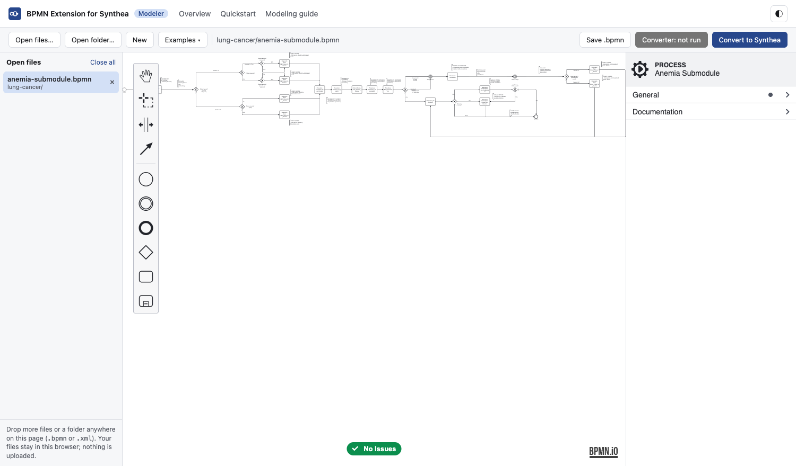
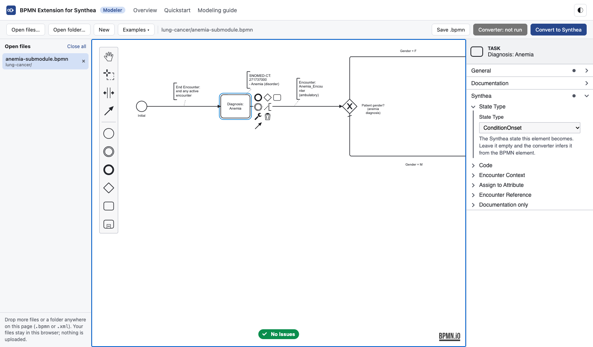
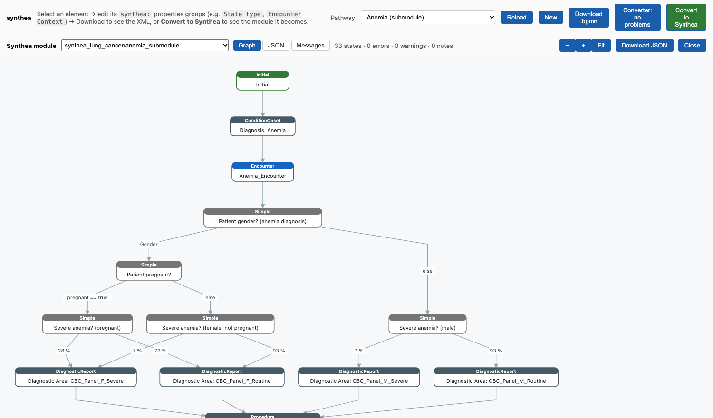

# Quickstart: your first module

About ten minutes. You need a browser and nothing else: the modeler on this site runs everything locally in the page.

## 1. Open an example

The modeler has no diagrams of its own: you open your files, which stay in your browser and are never uploaded. To follow this tutorial, open the **Examples** menu in the toolbar (or press **Try the lung cancer example** on the start screen) and choose **Anemia (submodule)**. The file appears in the list on the left and as a diagram on the canvas: circles, boxes and diamonds connected by arrows. If you are not sure what they mean, read [Basics](basics.md) first.

You can also download the file, [anemia-submodule.bpmn](/examples/anemia-submodule.bpmn) (right-click, save link as), and drag it onto the page or press **Open files…**. That is how you open your own files later. The example files also carry data of other extensions (`i18n:` for translated labels, `cp:` for clinical pathway data); the modeler and the converter ignore it.

The other examples, all from the lung cancer pathway, as downloads: [main pathway](/examples/synthea-lung-cancer.bpmn), [probabilities](/examples/lung-cancer-probabilities-submodule.bpmn), [treatment cycle](/examples/lung-cancer-treatment-submodule.bpmn) and [symptom check](/examples/symptom-check-submodule.bpmn). The main pathway calls the four others, so open it together with them: **Lung cancer pathway: all five files** in the Examples menu does that, and for downloaded files put all five in one folder and use **Open folder…**.

## 2. Look at one element

Click the task **Diagnosis: Anemia**. On the right, the **properties panel** shows what you can set. The group called **Synthea** is the new part. Its **State Type** says what the box becomes in Synthea, here `ConditionOnset`: the patient gets a diagnosis. The section **Code** holds the code system, the code and the display text of that diagnosis. Fields that are easy to get wrong have a short explanation under them.

Further sections appear depending on the state type: for a box that sets an attribute, **Set Attribute** holds the attribute name and its value. Click a few other elements and watch the groups change.

## 3. Change something and convert

Click a flow that leaves one of the gateways **Severe anemia?**: the section **Probability** holds its probability. The numbers of all flows of one gateway must add up to 1.0. Change one, and the green **No Issues** at the bottom of the canvas tells you what is wrong, while you work. Set it back.

Then press **Convert to Synthea** in the toolbar. A panel opens with the Synthea module the diagram becomes, in three tabs:

- **Graph**: the module as a state graph.
- **JSON**: the file Synthea runs. **Download JSON** saves it.
- **Messages**: problems and hints the converter found. Each message comes with an explanation and what to do.

The one warning says that the diagnosis comes right after `Initial`, so every patient would get it at birth. That is fine here: the anemia module only runs when the main pathway calls it. The conversion runs only when you press the button; after your next change the toolbar says it has not run since.

Your changes stay in your browser, and the modeler restores your files when you come back. **Save .bpmn** (or Ctrl/Cmd+S) downloads your diagram; a dot next to a file name in the list marks unsaved changes.

## 4. Draw a tiny pathway

Press **New** in the toolbar. You get the smallest complete module: a start event joined to an end event. The start event is the state `Initial`, the end event the state `Terminal`; there is nothing to configure, and the converter reports no problem. Now put a state in between:

1. Drag the double circle (intermediate event) from the palette on the left onto the arrow between the two events. It is inserted into the flow. Click the wrench next to it (**Change element**) and choose **Timer intermediate catch event**.
2. With the timer selected, open the group **Synthea**, then **Delay** in the properties panel: choose the shape **EXACT**, enter the value `3` and the unit `years`.
3. Press **Convert to Synthea**. The result has three states: `Initial`, your delay (3 years) and `Terminal`. On the JSON tab you see them as the file Synthea runs.

This is the smallest working module. More steps (conditions, branches, visits) follow the same pattern: one BPMN element, one state type, a few fields. The [modeling guide](modeling-guide.md) shows each of them.

## 5. On the command line, and in Synthea

**Save .bpmn** and put the file into a folder of its own: one folder is one pathway, and the files in it may call each other. With a checkout of the repository, `npm run bpmn2gmf -- my-pathway --strict` converts the folder, and one more command runs the modules in Synthea and writes synthetic FHIR patients. Both are described in [What the converter does](converter-overview.md).

## Next

[Modeling guide](modeling-guide.md): every kind of step, one section each.
